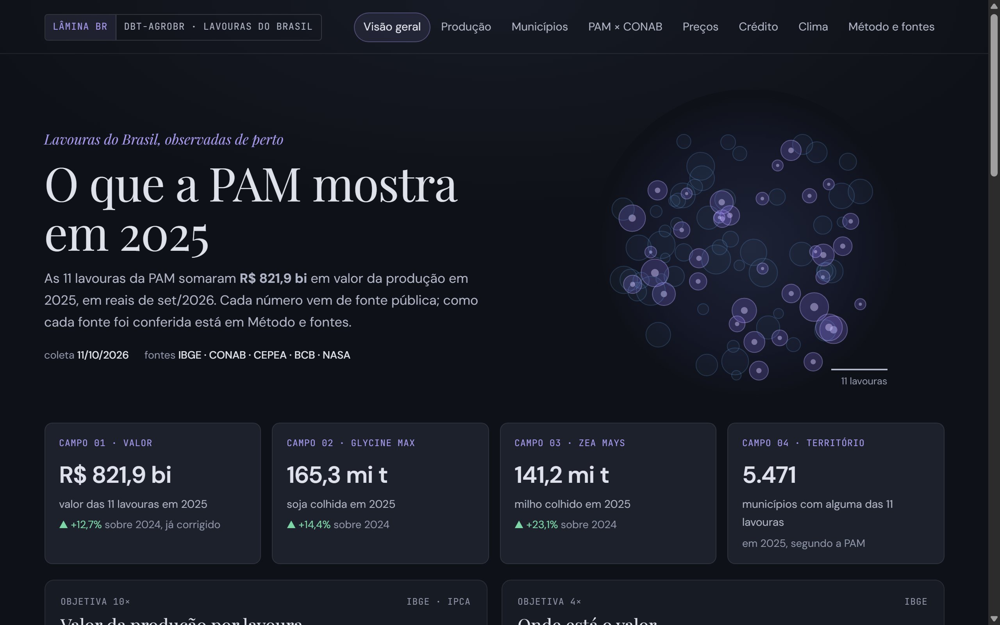
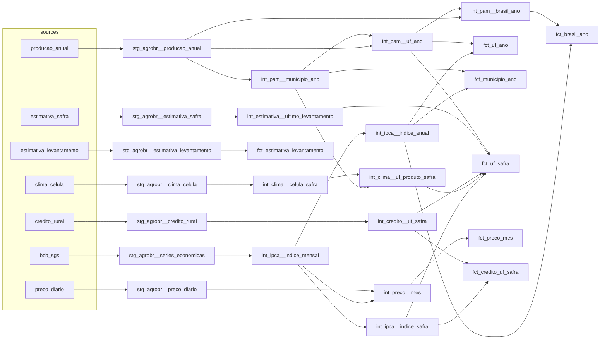

# dbt-agrobr

[](https://github.com/bruno-portfolio/dbt-agrobr/actions/workflows/ci.yml)
[](https://github.com/bruno-portfolio/dbt-agrobr/actions/workflows/atualizar.yml)
[](https://github.com/bruno-portfolio/dbt-agrobr/actions/workflows/docs.yml)

[Português](README.md) · **[Dashboard](https://bruno-portfolio.github.io/dbt-agrobr/)** (in Portuguese) · [dbt docs](https://bruno-portfolio.github.io/dbt-agrobr/dbt/) · [Latest load](https://github.com/bruno-portfolio/dbt-agrobr/releases/tag/dados)

A [dbt](https://docs.getdbt.com/) project on top of [agrobr](https://github.com/bruno-portfolio/agrobr), the
Python library for Brazilian agricultural data. It runs on [DuckDB](https://duckdb.org/), locally, with no server,
and feeds a static dashboard with production, crop estimates, prices, rural credit and weather for 12 crops. Every
month a workflow fetches what changed at the sources, runs dbt with every test on the real data and only then
publishes the dashboard.

[](https://bruno-portfolio.github.io/dbt-agrobr/)

| Source | What comes in | Since | New data |
|---|---|---|---|
| IBGE, PAM (table 5457) | area, production, yield and value of 11 crops by municipality, state and Brazil | 2015 | one year at a time, when IBGE publishes it |
| CONAB | area, production and yield by state for 6 grains; every monthly survey since season 2022/23 | season 2015/16 | every month |
| CEPEA/ESALQ | 6 daily price indicators | Jul 2015 | every business day |
| Central Bank of Brazil, SICOR | operating credit (custeio) by state and product for 10 crops | season 2015/16 | one season at a time, when it closes in June |
| IBGE, IPCA (via SGS 433) | deflator | Jan 2014 | every month |
| NASA POWER | rainfall and temperature for the grid cells of municipalities | Jul 2014 | one crop year at a time, along with PAM |

## What the data shows

Three readings from the October 2026 load, recomputed from the marts:

- **PAM and CONAB agree, but are not the same.** In the 60 grain × season combinations from 2015/16 to 2024/25, the
  CONAB Brazil total stayed within 8% of PAM, except for beans in 2016/17 (+11.6%). Both measure the same season with
  different methods; the gap is not an error of either.
- **The CONAB estimate moves during the season.** For soybeans, from the first survey (October) to the latest figure,
  the estimate moved between −6.6% (2023/24: 162.0 million t in the first survey, 151.3 million in the revised
  historical series) and +4.5% (2022/23), across seasons 2022/23 to 2025/26.
- **Soybeans concentrate in few municipalities.** In 2025, 123 of the 2,641 municipalities with soybeans in PAM
  produced half of the country's 165.3 million t.

## Decisions

- **DuckDB, no warehouse.** The data fits in about 36 MB of Parquet and the build with every test takes seconds.
  Anyone can reproduce the project without a cloud account, and the same SQL runs on dbt v1 and v2.
- **Loading outside dbt, by partition.** Each agrobr call becomes a Parquet file, with its provenance in a manifest.
  A closed partition (PAM year, closed season, published survey) is never fetched again; only what the source still
  changes is renewed. An empty response means "not published yet": nothing is written and nothing is deleted.
- **CONAB revisions as files, not as a snapshot.** Each survey comes out in its own bulletin, and the load keeps all of
  them (`estimativa_levantamento`). Revisions become a plain mart that rebuilds from scratch. A `dbt snapshot` would
  depend on database state between runs and would lose the history if the database were rebuilt.
- **No incremental models.** The largest mart has 673 thousand rows; incremental models would add state and edge cases
  with no noticeable time gain.
- **Weather by cell, weighted by area.** One grid point per state would assign one place's rainfall to a whole state.
  Here each municipality falls in a 0.5° × 0.625° cell and the state gets the cell average weighted by the crop's
  planted area.
- **"Not published" is not zero.** In PAM, "..." becomes null and "-" becomes zero; the municipal map shows them
  differently.
- **Contracts on the marts.** The 10 marts have enforced types (`contract: enforced`): a type change at the source
  breaks the build before it reaches the dashboard.
- **Checks outside agrobr.** Before publication, each source was compared with the primary source by a separate
  program; the table is in the dashboard, under Método e fontes.

## Automatic updates

The [`atualizar`](.github/workflows/atualizar.yml) workflow runs on the 16th of every month, and on demand:

1. restores the latest load, kept in the [`dados`](https://github.com/bruno-portfolio/dbt-agrobr/releases/tag/dados) release;
2. loads only what changed: IPCA, CEPEA, recent CONAB seasons and new surveys, the last closed SICOR season, a new PAM
   year and, once a year, weather;
3. runs `dbt source freshness` and `dbt build` on the real data (every test and contract);
4. exports the dashboard, puts the data back in the release, commits `painel/dados` and publishes to Pages.

If a source fails, the previous data stays and the workflow opens or comments on the "Atualização automática com
problema" issue; the next clean run closes it. Weather is 1,393 calls to NASA POWER and the full load takes about
11 hours: it does not fit in a 6-hour job, so the load stops at 4 hours and the workflow dispatches itself until done.

## Layers

| Medallion | In this project | In agrobr |
|---|---|---|
| Bronze | outside dbt | `agrobr.bruto`: the source's original file + manifest |
| Silver | sources `agrobr` and `agrobr_pontos`, `stg_agrobr__*` | datasets with contracts: versioned schema, `MetaInfo` with provenance |
| Gold | `int_*`, `dim_*`, `fct_*` | — |

Staging only renames, casts and converts to the project units (ha, t, kg/ha, BRL, BRL/t). Business rules live in
the intermediate layer: season × calendar year per product, IPCA deflation, choice of the CONAB estimate, weather
weighted by planted area. The marts join and expose; the dashboard is declared as an `exposure`.

## Lineage



The seeds (`uf`, `municipios_ibge`, `unidades`, `produtos`, `indicadores_cepea`) feed staging, intermediate and
the dimensions. `dbt docs` shows the full graph, with every column's description and the dashboard.

## Models

| Model | Grain | What it does |
|---|---|---|
| `fct_brasil_ano` | year × product | Brazil PAM, real value and the sum of states for checking |
| `fct_uf_ano` | state × year × product | PAM by state, share of Brazil and rank |
| `fct_municipio_ano` | municipality × year × product | municipal PAM, share of state and Brazil |
| `fct_uf_safra` | state × season × product | the 6 CONAB grains: PAM of the harvest year, CONAB, credit and weather |
| `fct_estimativa_levantamento` | state × season × product × survey | every monthly CONAB estimate and the change from the previous one |
| `fct_preco_mes` | product × market × month | monthly mean of the CEPEA indicator, nominal and real |
| `fct_credito_uf_safra` | state × season × product × purpose | SICOR operating credit, nominal and real |
| `dim_municipio`, `dim_produto`, `dim_safra` | — | dimensions; `dim_produto` tells which sources cover each product |

Conventions that change how the numbers read:

- **Season × calendar year.** For grains, season 2023/24 maps to PAM 2024. CONAB labels wheat by harvest year
  ("2024" in the historical series); here it becomes season 2023/24, like the other grains, and the mapping was
  checked against each year's figures. Production of coffee, cocoa, sugarcane, cassava and orange stays by calendar
  year; operating credit for every product follows the July–June season.
- **Prices belong to markets**, not states (soybeans at Paranaguá, corn in the Campinas region, and so on), so they
  stay out of `fct_uf_safra`. The official name of each indicator is in the `indicadores_cepea` seed.
- **Cotton:** PAM and CONAB measure seed cotton; CEPEA prices lint. Production and price are not multiplied.
- **Weather:** each municipality falls in a 0.5° × 0.625° NASA POWER (MERRA-2) grid cell; a state's weather for a
  product is the cell average weighted by planted area, July to June, complete months only, and only for grains
  planted in spring and summer. It is a descriptive crop year: part of the second- and third-crop harvest falls after
  June.
- **Real values** are in reais of the last IPCA month loaded (var `mes_base_ipca` to pin another month).

## Tests

Beyond the generic ones (keys, nulls, domains, ranges, relationships): municipalities add up to the state row
published by IBGE and states add up to Brazil, within 0.1% (a missing state or Brazil row also fails); the CONAB
Brazil total stays within 15% of PAM for the historical-series seasons; harvested area ≤ planted area; every unit
used in PAM, CONAB and CEPEA exists in the `unidades` seed; no empty IPCA month; a unit test for the estimate choice;
and one test per macro. The marts have contracts, the monthly sources have freshness limits and the load has its own
tests in `carga/test_carregar.py`.

## Running with the fixture

Python 3.11 to 3.13.

```bash
python -m venv .venv
source .venv/bin/activate                        # Windows: .venv\Scripts\activate
pip install -r requirements.txt
export DBT_PROFILES_DIR=profiles                 # PowerShell: $env:DBT_PROFILES_DIR = "profiles"
dbt deps
dbt build --target ci --vars "{agrobr_dados: fixtures/dados}"
sqlfluff lint models macros tests
```

The fixture (`fixtures/dados`, 167 KB) is a real slice of the full load: soybeans, PAM 2024 at every level, CONAB
(with the 12 surveys) and SICOR for season 2023/24, CEPEA from July 2023 to June 2024, IPCA for 2023–2024 and the
weather cell of the Federal District. Rebuild it with `python fixtures/recortar.py` after a load. dbt v2
(`requirements-v2.txt`, in another venv) runs the same dbt commands (SQLFluff stays in the v1 venv); CI tests both.

## Running with the full load

The load uses agrobr 2.0 and writes `dados/<table>/*.parquet` (outside git), with each call's provenance in
`dados/_manifesto.jsonl` and failures in `dados/_erros.jsonl`. Periods come from today's date (`--hoje` sets another).
To skip the load, download the latest one from the `dados` release.

```bash
# in a separate venv, with agrobr
pip install -r requirements-carga.txt
python carga/carregar.py pam       # and conab, cepea, sicor, ipca
python carga/carregar.py clima     # 1,393 NASA POWER cells; about 11 hours
pytest carga

# or the latest ready load
gh release download dados -R bruno-portfolio/dbt-agrobr -p dados.tar.gz && tar -xzf dados.tar.gz

# in the dbt venv
dbt build                          # dev target, writes agrobr.duckdb
dbt source freshness
python painel/exportar.py          # dashboard JSON in painel/dados
python -m http.server -d painel    # http://localhost:8000
```

## Dashboard

`painel/` is a static site (HTML, CSS and JavaScript, charts with [Apache ECharts](https://echarts.apache.org/)
6.1.0) that reads the JSON exported from the marts. The `docs.yml` workflow publishes the dashboard and `dbt docs`
to GitHub Pages on every push and at the end of every update.

## License

The code is under the MIT license ([LICENSE](LICENSE)). ECharts is under Apache 2.0
([painel/assets/vendor/echarts-6.1.0](painel/assets/vendor/echarts-6.1.0)).

## Data license

The data keeps each source's license; each source table's `config.meta` carries agrobr's classification, and the
marts carry it per row in the `licencas` column. In the `painel/dados` files and the `dados` release: rural credit,
derived from the Central Bank's Rural Credit Data Matrix, is under
[ODbL 1.0](https://opendatacommons.org/licenses/odbl/1-0/); prices, derived from CEPEA/ESALQ, are under
[CC BY-NC 4.0](https://creativecommons.org/licenses/by-nc/4.0/), no commercial use; the rest is open data from IBGE,
CONAB and NASA, with the source cited.
