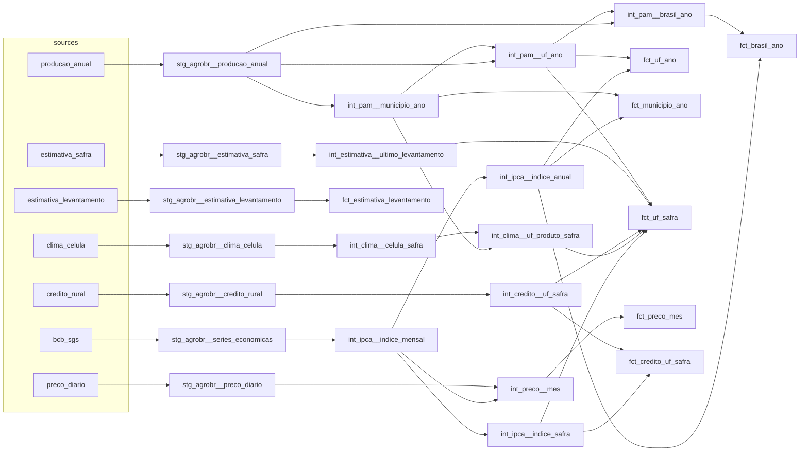

# dbt-agrobr

[](https://github.com/bruno-portfolio/dbt-agrobr/actions/workflows/ci.yml)
[](https://github.com/bruno-portfolio/dbt-agrobr/actions/workflows/atualizar.yml)
[](https://github.com/bruno-portfolio/dbt-agrobr/actions/workflows/docs.yml)

[English](README.en.md) · **[Painel](https://bruno-portfolio.github.io/dbt-agrobr/)** · [Documentação dbt](https://bruno-portfolio.github.io/dbt-agrobr/dbt/) · [Dados da última carga](https://github.com/bruno-portfolio/dbt-agrobr/releases/tag/dados)

Projeto [dbt](https://docs.getdbt.com/) sobre os dados do [agrobr](https://github.com/bruno-portfolio/agrobr), a
biblioteca Python de dados agrícolas brasileiros. Roda em [DuckDB](https://duckdb.org/), local, sem servidor, e
alimenta um painel estático com produção, estimativas de safra, preços, crédito rural e clima de 12 lavouras. Todo
mês, um workflow baixa o que mudou nas fontes, roda o dbt com todos os testes sobre os dados reais e só então
publica o painel.

[](https://bruno-portfolio.github.io/dbt-agrobr/)

| Fonte | O que entra | Desde | Novos dados |
|---|---|---|---|
| IBGE, PAM (tabela 5457) | área, produção, rendimento e valor de 11 lavouras por município, UF e Brasil | 2015 | um ano por vez, quando o IBGE publica |
| CONAB | área, produção e produtividade por UF de 6 grãos; cada levantamento mensal desde a safra 2022/23 | safra 2015/16 | todo mês |
| CEPEA/ESALQ | 6 indicadores diários de preço | jul/2015 | todo dia útil |
| Banco Central, SICOR | custeio por UF e produto de 10 lavouras | safra 2015/16 | uma safra por vez, ao fechar em junho |
| IBGE, IPCA (via SGS 433) | deflator | jan/2014 | todo mês |
| NASA POWER | chuva e temperatura por célula da grade dos municípios | jul/2014 | um ano agrícola por vez, junto com a PAM |

## O que os dados mostram

Três leituras da carga de outubro de 2026, refeitas a partir dos marts:

- **PAM e CONAB concordam, mas não são iguais.** Nas 60 combinações de grão e safra de 2015/16 a 2024/25, o total
  Brasil da CONAB ficou a menos de 8% da PAM, exceto no feijão 2016/17 (+11,6%). As duas medem a mesma safra por
  métodos diferentes; a diferença não é erro de nenhuma.
- **A estimativa da CONAB anda ao longo da safra.** Na soja, do 1º levantamento (outubro) ao número mais recente, a
  estimativa variou de −6,6% (2023/24: 162,0 milhões de t no 1º levantamento, 151,3 milhões na série histórica
  revisada) a +4,5% (2022/23), nas safras de 2022/23 a 2025/26.
- **A soja se concentra em poucos municípios.** Em 2025, 123 dos 2.641 municípios com soja na PAM responderam por
  metade dos 165,3 milhões de t do país.

## Decisões

- **DuckDB, sem warehouse.** Os dados cabem em cerca de 36 MB de Parquet e o build com todos os testes leva segundos.
  Qualquer pessoa reproduz o projeto sem conta em nuvem, e o mesmo SQL roda no dbt v1 e no v2.
- **Carga fora do dbt, por partição.** Cada chamada ao agrobr vira um Parquet, com a proveniência registrada num
  manifesto. Partição fechada (ano da PAM, safra encerrada, levantamento publicado) não é baixada de novo; só se
  renova o que a fonte ainda muda. Resposta vazia quer dizer "ainda não publicado": não grava nada nem apaga o que
  havia.
- **Revisões da CONAB como arquivos, não como snapshot.** Cada levantamento sai num boletim próprio, e a carga guarda
  todos (`estimativa_levantamento`). A revisão vira um mart comum, que se refaz do zero. Um `dbt snapshot`
  dependeria do estado do banco entre execuções e perderia o histórico se o banco fosse refeito.
- **Sem modelos incrementais.** O maior mart tem 673 mil linhas; incremental traria estado e casos de borda sem ganho
  de tempo que se note.
- **Clima por célula, ponderado pela área.** Um ponto de grade por UF poria a chuva de um lugar só para um estado
  inteiro. Aqui cada município cai numa célula de 0,5° × 0,625° e a UF recebe a média das células, ponderada pela
  área plantada da lavoura.
- **"Não publicado" não é zero.** Na PAM, "..." vira nulo e "-" vira zero; o mapa municipal mostra os dois de forma
  diferente.
- **Contratos nos marts.** Os 10 marts têm tipos impostos (`contract: enforced`): uma mudança de tipo na fonte quebra
  o build antes de chegar ao painel.
- **Conferência fora do agrobr.** Antes da publicação, cada fonte foi comparada com a primária por outro programa; a
  tabela está no painel, em Método e fontes.

## Atualização automática

O workflow [`atualizar`](.github/workflows/atualizar.yml) roda no dia 16 de cada mês, e sob demanda:

1. restaura os dados da última carga, guardados na release [`dados`](https://github.com/bruno-portfolio/dbt-agrobr/releases/tag/dados);
2. carrega só o que mudou: IPCA, CEPEA, safras recentes e levantamentos novos da CONAB, a última safra fechada do
   SICOR, ano novo da PAM e, uma vez por ano, o clima;
3. roda `dbt source freshness` e `dbt build` com os dados reais (todos os testes e contratos);
4. exporta o painel, devolve os dados à release, commita `painel/dados` e publica no Pages.

Se uma fonte falha, fica o dado anterior e o workflow abre ou comenta a issue "Atualização automática com problema";
a próxima execução sem problema a fecha. O clima são 1.393 chamadas ao NASA POWER e a carga completa leva cerca de
11 h: não cabe nas 6 h de um job, então a carga para em 4 h e o workflow dispara a si mesmo até terminar.

## Camadas

| Medallion | Neste projeto | No agrobr |
|---|---|---|
| Bronze | fora do dbt | `agrobr.bruto`: arquivo original da fonte + manifesto |
| Prata | sources `agrobr` e `agrobr_pontos`, `stg_agrobr__*` | datasets com contrato: schema versionado, `MetaInfo` com proveniência |
| Ouro | `int_*`, `dim_*`, `fct_*` | — |

O staging só renomeia, tipa e converte para as unidades do projeto (ha, t, kg/ha, BRL, BRL/t). A regra de
negócio fica no intermediate: safra × ano civil por produto, deflação pelo IPCA, escolha da estimativa da CONAB,
clima ponderado pela área plantada. Os marts juntam e expõem; o painel é declarado como `exposure`.

## Linhagem



As seeds (`uf`, `municipios_ibge`, `unidades`, `produtos`, `indicadores_cepea`) entram no staging, no
intermediate e nas dimensões. O `dbt docs` mostra o grafo completo, com a descrição de cada coluna e o painel.

## Modelos

| Modelo | Grão | O que faz |
|---|---|---|
| `fct_brasil_ano` | ano × produto | PAM do Brasil, valor real e a soma das UFs para conferência |
| `fct_uf_ano` | UF × ano × produto | PAM por UF, participação no Brasil e posição no ranking |
| `fct_municipio_ano` | município × ano × produto | PAM municipal, participação na UF e no Brasil |
| `fct_uf_safra` | UF × safra × produto | os 6 grãos da CONAB: PAM do ano da colheita, CONAB, custeio e clima |
| `fct_estimativa_levantamento` | UF × safra × produto × levantamento | cada estimativa mensal da CONAB e a variação sobre a anterior |
| `fct_preco_mes` | produto × praça × mês | média mensal do indicador do CEPEA, nominal e real |
| `fct_credito_uf_safra` | UF × safra × produto × finalidade | custeio do SICOR, nominal e real |
| `dim_municipio`, `dim_produto`, `dim_safra` | — | dimensões; `dim_produto` diz quais fontes cobrem cada produto |

Convenções que mudam a leitura dos números:

- **Safra × ano civil.** Nos grãos, a safra 2023/24 corresponde à PAM de 2024. A CONAB rotula o trigo pelo ano da
  colheita ("2024" na série histórica); aqui ele vira a safra 2023/24, como os demais grãos, e a correspondência foi
  conferida com os números de cada ano. A produção de café, cacau, cana, mandioca e laranja fica só por ano civil; o
  crédito de custeio de todos os produtos segue a safra de julho a junho.
- **Preços são de praças**, não de UFs (soja em Paranaguá, milho na região de Campinas, e assim por diante); por isso
  não entram no `fct_uf_safra`. O nome oficial de cada indicador está na seed `indicadores_cepea`.
- **Algodão:** PAM e CONAB medem em caroço; o CEPEA, em pluma. Produção e preço não se multiplicam.
- **Clima:** cada município cai numa célula de 0,5° × 0,625° do NASA POWER (MERRA-2); o clima de uma UF para um produto
  é a média das células ponderada pela área plantada, de julho a junho, só com meses completos e só nos grãos plantados
  na primavera e no verão. É um ano agrícola descritivo: parte da colheita da segunda e da terceira safra cai depois de
  junho.
- **Valores reais** em reais do último mês do IPCA carregado (var `mes_base_ipca` para fixar outro).

## Testes

Além dos genéricos (chaves, nulos, domínios, faixas, relações): soma dos municípios = UF publicada pelo IBGE e soma
das UFs = Brasil, com tolerância de 0,1% (UF ou Brasil ausente também reprova); total Brasil da CONAB a menos de 15%
da PAM nas safras da série histórica; área colhida ≤ plantada; toda unidade usada na PAM, na CONAB e no CEPEA existe
na seed `unidades`; IPCA sem mês vazio; um teste unitário da escolha da estimativa; e um teste por macro. Os marts
têm contrato, as sources mensais têm limite de frescor e a carga tem testes próprios em `carga/test_carregar.py`.

## Como rodar com a fixture

Python 3.11 a 3.13.

```bash
python -m venv .venv
source .venv/bin/activate                        # Windows: .venv\Scripts\activate
pip install -r requirements.txt
export DBT_PROFILES_DIR=profiles                 # PowerShell: $env:DBT_PROFILES_DIR = "profiles"
dbt deps
dbt build --target ci --vars "{agrobr_dados: fixtures/dados}"
sqlfluff lint models macros tests
```

A fixture (`fixtures/dados`, 167 KB) é um recorte real da carga completa: soja, PAM de 2024 em todos os níveis,
CONAB (com os 12 levantamentos) e SICOR da safra 2023/24, CEPEA de julho de 2023 a junho de 2024, IPCA de 2023–2024
e a célula de clima do Distrito Federal. Refazer: `python fixtures/recortar.py` depois de uma carga. O dbt v2
(`requirements-v2.txt`, em outro venv) roda os mesmos comandos dbt (o SQLFluff fica no venv da v1); o CI testa os
dois.

## Como rodar com a carga completa

A carga usa o agrobr 2.0 e grava `dados/<tabela>/*.parquet` (fora do git), com a proveniência de cada chamada em
`dados/_manifesto.jsonl` e as falhas em `dados/_erros.jsonl`. Os períodos saem da data do dia (`--hoje` fixa outra).
Para não esperar a carga, baixe a última da release `dados`.

```bash
# num venv à parte, com o agrobr
pip install -r requirements-carga.txt
python carga/carregar.py pam       # e conab, cepea, sicor, ipca
python carga/carregar.py clima     # 1.393 células do NASA POWER; cerca de 11 h
pytest carga

# ou a última carga pronta
gh release download dados -R bruno-portfolio/dbt-agrobr -p dados.tar.gz && tar -xzf dados.tar.gz

# no venv do dbt
dbt build                          # alvo dev, grava em agrobr.duckdb
dbt source freshness
python painel/exportar.py          # JSON do painel em painel/dados
python -m http.server -d painel    # http://localhost:8000
```

## Painel

`painel/` é um site estático (HTML, CSS e JavaScript, gráficos com [Apache ECharts](https://echarts.apache.org/)
6.1.0) que lê os JSON exportados dos marts. O workflow `docs.yml` publica o painel e o `dbt docs` no GitHub Pages, a
cada push e ao fim de cada atualização.

## Licença

O código está sob a licença MIT ([LICENSE](LICENSE)). O ECharts está sob Apache 2.0
([painel/assets/vendor/echarts-6.1.0](painel/assets/vendor/echarts-6.1.0)).

## Licença dos dados

Os dados seguem a licença de cada fonte; o `config.meta` de cada tabela da source traz a classificação do agrobr e
os marts a carregam por linha na coluna `licencas`. Nos arquivos de `painel/dados` e da release `dados`: o crédito
rural, derivado da Matriz de Dados do Crédito Rural do Banco Central, está sob
[ODbL 1.0](https://opendatacommons.org/licenses/odbl/1-0/); os preços, derivados do CEPEA/ESALQ, sob
[CC BY-NC 4.0](https://creativecommons.org/licenses/by-nc/4.0/), sem uso comercial; os demais são dados abertos do
IBGE, da CONAB e da NASA, com a fonte citada.
